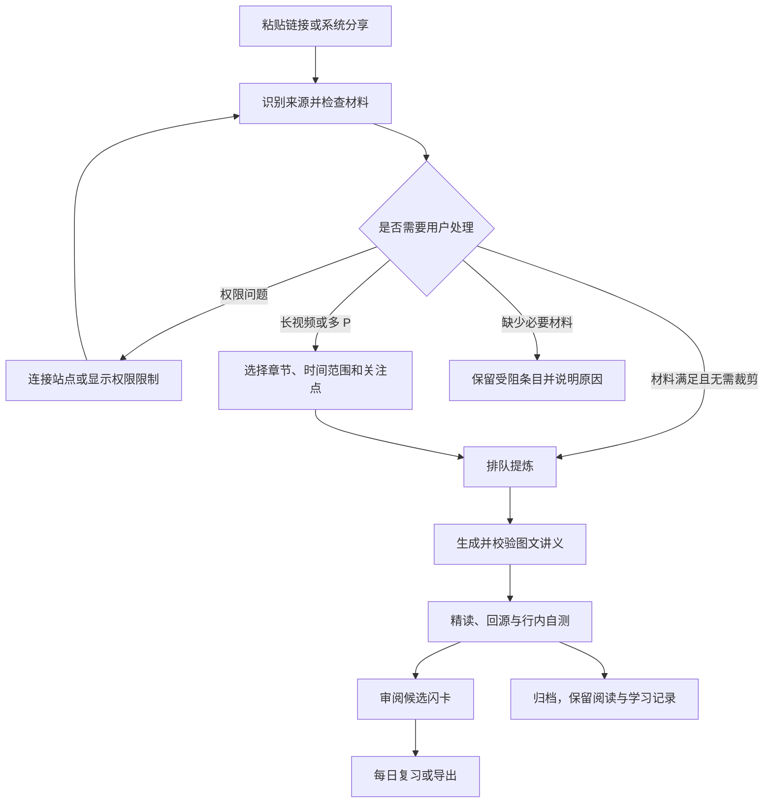

# FrameRead 产品需求文档

| 项目 | 内容 |
| --- | --- |
| 正式名称 | FrameRead（用户已确认）；DeepDeck 为早期代号 |
| 版本 | v0.1 |
| 日期 | 2026-11-11 |
| 状态 | 需求草案，供后续方案设计、任务拆解和验收使用；不代表已开发或已完成平台验证 |
| 产品类型 | 个人自用的多模态技术内容精读与知识内化工作台 |
| 核心输入 | B站技术视频、YouTube 技术视频、静态技术文章 |
| 核心输出 | 有来源锚点的 Markdown 深度讲义、少量机制自测、经用户筛选的记忆闪卡 |
| 需求来源 | [原始选题讨论稿](initial-concept.md) |
| 本文边界 | 定义业务、体验、数据含义与验收；不预选框架、数据库、模型、部署方式或代理协议 |

## 0. 阅读约定与原稿澄清

本文中的“必须”表示对应优先级的验收要求，不是当前实现状态。P0 为 MVP 发布边界，P1 在 P0 闭环完成后考虑；拟议参数和实验目标尚需实测，不是已有数据。

原稿作为历史来源保留，后续开发以本文和用户明确更新的决定为需求依据。为消除原稿内部的不一致，本版作以下整理：

| 议题 | 本版处理 | 性质 |
| --- | --- | --- |
| 产品名称 | 正式名称 FrameRead，历史代号仅留在原稿 | 用户已确认 |
| 登录与读取权限 | 站点登录态、字幕权限、视频流权限分别验证，登录成功不等于提取成功 | 事实核验与可行性约束 |
| 凭证即将过期 | 仅在存在可靠到期信息时展示；否则显示最近验证时间及“状态未知” | 避免伪造状态 |
| 无字幕转写 | ASR 为 P1；P0 无可用字幕时暂停并解释原因，不偷偷启动转写 | 对齐原稿 P1 清单 |
| 多 P 视频 | P0 提供分 P 列表与选择，以选中的 P / 时间段为解析单位；收藏夹同步仍为 P1 | 细化原稿边界 |
| 每日复习 | 将最小复习调度明确纳入 P0，补齐原稿已有 Review Tab 的业务闭环 | 本版补充，待整体评审 |
| 导出格式 | P0 为 CSV 与 Markdown 资源包；原生 `.apkg` 导出列为 P1 可选项 | 本版细化，非已确认技术选择 |
| 80 / 20 | 阅读设计原则，指正文承担主要解释职责；不按像素、字数或组件数强算比例 | 可操作化解释 |
| 行内交互 | P0 固定三种受控题型；不包含任意生成并执行前端代码 | 明确产品边界 |
| A2A 与生成式 UI | 保留为论文与方案候选，是否采用由后续验证决定 | 不提前锁定架构 |

## 1. 产品定位

### 1.1 一句话定义

FrameRead 将收藏夹里的硬核技术视频和文章，转化为保留技术上下文、关键配图与来源的精读讲义，并通过少量机制自测和可复习闪卡帮助用户内化知识。

### 1.2 问题与产品假设

目标用户在架构解析、源码走读、协议讲解和 Conference 演讲中，可能遇到线性观看耗时、关键画面难回找、简短总结缺少推导、手工制卡成本高等问题。这些是选题提出的用户假设，尚未经过系统访谈或对照实验，不将其写成覆盖所有用户或竞品的事实。

| 用户问题 | 产品响应 | 需要验证的假设 |
| --- | --- | --- |
| 视频内容密集，难以跳读和回溯 | 章节裁剪、连续讲义、截图时间锚点 | 同等理解水平下，精读总耗时是否降低 |
| 大纲式摘要不足以支持技术理解 | 背景、机制、例子、边界条件与权衡成文 | 用户能否回答机制题，而非只记住关键词 |
| 被动读完后误以为掌握 | 在关键章节提供少量可跳过的自测 | 自测是否能暴露理解偏差而不打断阅读 |
| 懂了以后缺少低成本复习材料 | 根据重点和错题生成候选卡，人工采纳 | 候选卡是否可用，修改成本是否足够低 |
| 内容获取受站点限制影响 | 显式授权状态、能力检测与可恢复任务 | 在目标平台和样本上能否稳定获取足够材料 |

### 1.3 核心原则

1. **深度正文优先**：连续讲清背景、推导和条件，保留必要代码与配图，不把讲义拆成信息卡片墙。
2. **交互服务理解**：优先介入范围确认、机制自测和闪卡分拣；常规阅读不依赖答题通关。
3. **来源可回查**：技术结论、截图、自测答案和闪卡能回到相应原文或视频片段。
4. **用户掌握最终选择权**：内容范围、额外耗时或费用、采纳的卡片与数据去向由用户控制。
5. **先保证可靠闭环**：任务可恢复、用户编辑不丢失、数据可导出，优先于视觉炫技与功能数量。

### 1.4 不承诺的能力

不承诺任意 URL 都可解析、任意站点登录后都可提取字幕、所有原图都能获得高清版本、所有客户端都能精准跳秒，也不承诺生成讲义能够替代原作者的所有表达。能力不足时必须说明具体缺口。

## 2. 用户与使用场景

### 2.1 目标用户

核心用户是项目作者本人及具有类似习惯的计算机相关专业学生、开发者：有一定编程基础，经常收藏中英文技术视频与文章，偏好文字精读，希望用碎片时间复习。MVP 围绕单个使用者组织内容，不设计团队权限、组织空间或站内社交。

### 2.2 典型场景

| 场景 | 用户希望完成的事 | 成功表现 |
| --- | --- | --- |
| 收藏后的再学习 | 将一段约半小时的架构视频转为可读讲义 | 保留架构图、机制说明与限制条件，可以快速回源 |
| 只学其中一部分 | 从长视频或多 P 内容中选取相关章节 | 生成范围明确，未选部分不被默默纳入 |
| 阅读源码分析文章 | 保留代码上下文与作者解释，去掉导航广告 | 标题层级、代码、表格和关键图片可读 |
| 验证理解 | 对时序、边界条件或代码判断做一次小测试 | 能看到答案理由及对应证据，错误变为候选复习点 |
| 通勤复习 | 用约五分钟处理今日的一部分待复习卡 | 评分后保存进度，随时退出不会丢失记录 |

### 2.3 不优先适配

纯娱乐视频、直播长录播、无讲解的纯操作录屏、扫描论文全文、动态交互网站、付费墙文章与需要复杂登录操作的站点，不作为 MVP 的强支持对象。识别出这些输入后给出明确结果，不输出貌似完整的虚构讲义。

## 3. 目标、指标与验证口径

### 3.1 MVP 成功定义

在经过验证的 B站、YouTube 和静态文章样本上，使用者能够独立完成“导入 → 范围确认 → 提炼 → 精读 / 自测 → 卡片分拣 → 一次复习或导出”，且不需要开发者修改数据库、手工拼接中间结果或伪装平台能力。

双平台视频接入均为 P0 目标。某个平台尚未验证通过时，可以继续开发其他闭环，但不能将 MVP 标记为全部完成；确需缩减范围时显式修订本 PRD。

### 3.2 指标定义

以下是拟议验收或实验目标，尚无基线和实测结果。数据默认本地记录并汇总，不引入远程用户画像系统。

| 指标 | 口径 | 本版目标 / 使用方式 |
| --- | --- | --- |
| 核心路径完成 | 每个受支持来源至少有一个真实样本走通完整链路 | 必须通过；演示夹具另行标注 |
| 支持范围内任务成功率 | 成功生成可用讲义数 / 具备必要权限与材料且已确认范围的任务数 | 建立样本集后测量；不以小样本声称普适可靠性 |
| 导入总体可用率 | 产出可用讲义数 / 全部合法导入数，并分列无字幕、权限受限等原因 | 同时报告，避免只挑选成功样本 |
| 关键结论可溯源率 | 可定位到来源的抽检结论数 / 抽检结论总数 | 目标 100%；补充解释必须另标来源属性 |
| 截图锚点完整率 | 有正确来源、P 信息和可解析时间值的截图数 / 截图总数 | 100%；定位精度在目标设备单独测量 |
| 讲义质量 | 按第 12 节量表评审 | 无严重事实错误，其他维度达到验收线 |
| 候选卡采纳率 | 直接采纳数、编辑后采纳数分别除以已审阅候选数 | 记录基线，用于迭代，不作为强制增长目标 |
| 学习效率 | 从开始阅读至完成同难度机制测验的时间，连同正确率比较 | 与原视频 / 普通摘要做探索性对照 |
| 延迟记忆 | 相同间隔后独立复测的正确率 | 探索性观察；自评“认识”不等于客观记住 |

任务等待、主动阅读时间、制卡时间分别统计，不能仅比较“视频时长”和“讲义阅读时长”。取消、失败、权限受阻与用户主动裁剪应单独归类。

## 4. MVP 范围与优先级

| 需求编号 | 能力 | 优先级 | 发布边界 |
| --- | --- | --- | --- |
| FR-01 | B站 / YouTube 单链接及静态文章 URL 导入、去重 | P0 | 含多 P 入口识别；不批量解析任意链接文本 |
| FR-02 | 目标移动端系统分享入口 | P0 | 先选定一个主要移动系统，不同时承诺双端 |
| FR-03 | 站点连接、健康状态、解除与重授权 | P0 | 具体授权方式待站点验证，不承诺通用内嵌登录 |
| FR-04 | 长视频 / 多 P 的范围确认及关注点 | P0 | 无章节时提供明确标注的时间段裁剪 |
| FR-05 | 异步任务、取消、重试与结果通知 | P0 | 执行环境待定；不能依赖用户一直停留在阅读器 |
| FR-06 | 字幕提取与静态文章正文清洗 | P0 | 无字幕视频明确受阻，ASR 不在 P0 |
| FR-07 | 有价值关键帧、时间锚点与回源 | P0 | 仅抽取必要画面，不构建离线视频库 |
| FR-08 | 结构化深度讲义生成与来源标注 | P0 | 不把薄弱材料伪装成完整推导 |
| FR-09 | Markdown 沉浸阅读与进度保存 | P0 | 含公式、代码、表格、目录、图片缩放 |
| FR-10 | 排序 / 概念辨析 / 代码挖空三种行内自测 | P0 | 题型能力齐备，每篇按内容适配，不强塞三种 |
| FR-11 | 重点与错题驱动的候选闪卡 | P0 | 问答、Cloze、图文问答；追问信号待 P1 |
| FR-12 | 滑动分拣、编辑、撤销与本地保存 | P0 | 提供等价按钮，未采纳卡不进复习 |
| FR-13 | 每日待复习流与最小间隔调度 | P0 | 认识 / 模糊 / 忘记，历史和到期时间持久化 |
| FR-14 | CSV 与 Markdown 资源包导出 | P0 | 不承诺 CSV 保留外部工具全部调度状态 |
| FR-15 | 偏好、存储与内容生命周期管理 | P0 | 不做产品账号和跨设备云同步 |
| FR-16 | B站稍后再看 / 收藏夹拉取 | P1 | 先按需刷新和批量勾选；自动刷新后续验证 |
| FR-17 | 无字幕视频 ASR 兜底 | P1 | 必须先确认时长、费用与材料可获取性 |
| FR-18 | 划词 / 指图追问与持久批注 | P1 | 保留定位，回答可溯源，用户决定是否写入 |
| FR-19 | 原生 `.apkg` 导出 | P1 可选 | 在必要性与兼容性验证后实施 |

### 4.1 明确不做

- 完整离线视频下载、全功能播放器、视频剪辑或通用媒体管理。
- 全视频逐帧多模态理解，以及对纯视觉无讲解录屏的强支持。
- 任意站点爬虫、绕过登录 / 付费 / 地区限制的获取机制。
- 用户注册、云端多账号、协作空间、推荐广场、评论与内容交易。
- 任意 AI 生成代码的执行环境、自由布局页面生成器、无限题型编辑器。
- 在 P0 引入自动双向 Anki 同步、复杂学习统计或完整笔记管理系统。

## 5. 端到端业务流程

### 5.1 标准视频路径

用户分享视频，系统立即保留入口与任务标识，随后识别标题、时长、分 P、章节与字幕可用性。若超过默认 20 分钟或为多 P 内容，先确认范围，再进入较重的画面提取与讲义生成。用户离开页面后任务仍被记录，完成后在收件箱显示结果；支持通知的环境发出本地提醒。

讲义先交付连续正文，关键图与机制测试穿插在相关章节后。用户可以直接回源，也可以跳过自测。文末展示候选卡，采纳后进入本地复习队列；用户可随时导出或归档。

### 5.2 静态文章路径

输入文章 URL 后提取正文并保留标题层级、代码、表格、公式和必要图片。不经过视频时长判断，不产生虚构时间戳。篇幅过长时可提示先选择标题范围，但不是 P0 必须具备的文章裁剪器。后续阅读、候选制卡、复习与导出与视频路径共用业务规则。

### 5.3 受阻与恢复路径

字幕缺失、授权失效、权限不足、站点风控与网络错误采用不同状态和说明。只有可由登录解决的问题才引导重授权；权限不足不能反复要求登录。P0 不具备转写能力时保留条目，用户可以回到原文学习或稍后重试，不把字幕为空判为生成成功。

## 6. 功能需求与验收

### FR-01：链接导入与去重（P0）

**用户故事**：我希望随手交给系统一个技术内容链接，不必先选择平台或手工整理信息。

- 接受 B站单视频 / 多 P 链接、YouTube 单视频链接、静态文章 HTTP(S) URL。识别不了时明确提示类型，不尝试作为系统命令执行。
- 分享附带标题、说明文字时提取一个明确链接；存在多个候选时让用户选择一个。P0 不静默批量导入。
- 保存原始入口和规范化来源身份。移除无关追踪参数时，保留影响内容的分 P、视频 ID 等信息；播放时间可作为范围建议，不能悄悄替代用户选择。
- 同一来源的重复投递优先打开已有条目；不同范围可建立新的讲义版本或任务，并在再次消耗资源前提示。
- 短链接在解析实际目标后重新做来源与访问边界检查；过期链接显示原始入口和失败原因。

**验收**：分别导入三类支持来源可形成持久条目；同一视频的两种 URL 形式不会误建相同任务；同一视频的不同 P 不会被错误合并；非法输入不进入提炼阶段。

### FR-02：系统分享入口（P0）

- 在选定的主要移动系统中作为分享目标接收 URL；“一键投递”指先可靠收下链接，不表示直接跳过范围、权限或费用确认。
- App 未打开时仍能保存或明确告知未保存；网络不可用时保留待识别条目。
- 回到 App 后显示刚投递内容及状态，重复点分享不产生重复任务。

**验收**：从至少一个目标视频 App 和一个浏览器分享实际链接成功；冷启动、重复分享和断网场景不丢入口。纯网页粘贴演示不能替代系统分享验收。

### FR-03：站点连接与登录态管理（P0）

- 设置页按站点显示连接入口、当前状态、最近验证时间和解除连接操作。每站点先支持一个活动连接，不引入 FrameRead 自有账号。
- 采用站点允许且经过验证的授权流程，入口可调用系统浏览器、站点网页或扫码流程。能否内嵌登录、能取得哪些权限，分别做可行性验证，不在 PRD 中规定抓 Cookie 的实现。
- 状态至少包括：未连接、验证中、可用、状态未知、已失效、权限不足；确有可靠到期时间时补充“即将过期”。
- “可用”须说明验证的是连接，不能等同于所有视频、字幕、画质和收藏夹均可读取；任务还要检查实际所需能力。
- 解除连接清除所存凭证，停止使用该连接；已生成讲义和闪卡继续可读。正在等待该连接的任务保持可解释状态。
- 重授权后仅恢复原本可执行、仍未取消且权限问题已解除的任务；恢复不得新建重复讲义。

**验收**：失效连接可恢复原任务；权限不足有独立提示；解除连接后无凭证残留使用；日志、导出文件、讲义和模型输入中无站点凭证。

### FR-04：解析范围与关注点确认（P0）

- 默认视频时长超过 20 分钟，或包含多 P 时进入范围确认；该数值为原稿提出的初始产品参数，后续可调。
- 优先展示平台章节与分 P。无平台章节但有字幕时，可展示标注为“自动划分”的大纲；缺乏可靠标题时使用时间区间，不伪装为官方目录。
- 支持多选章节、选择 P、必要时调整起止时间；至少保留一个有效片段。重叠区间合并，跨 P 的相对时间分开记录。
- 可选关注点：原理推导、工程实现、代码细节、面试复习；不填写也可继续。默认输出中文讲义，保留原始技术术语。
- 确认前展示总选取时长、字幕来源及可识别的额外成本；估算不可靠时显示未知。只允许与范围确认有关的轻量检测先运行。
- 改变范围后重新计算预期材料与成本；不能沿用旧范围的确认启动新消耗。

**验收**：30 分钟视频选择其中一节后，讲义仅覆盖所选范围及必要、明确标注的背景补充；多 P 截图回源携带正确 P；无章节内容仍可裁剪；选择为空不能提交。

### FR-05：异步任务与反馈（P0）

- 每个任务展示真实阶段，如识别来源、等待确认、排队、获取文稿、提取画面、生成讲义、校验结果。无可靠进度时只显示阶段，不编造百分比。
- 支持取消未完成任务、重试可恢复失败、查看简明原因；有效中间结果可复用，但范围或来源版本变化后需重新判断适用性。
- 任务和用户确认在离开页面、App 重启后可恢复。移动操作系统是否允许持续后台计算取决于执行环境；不能声称仅靠页面关闭后的本地进程即可无限运行。
- 完成后更新收件箱；本地通知在用户允许且系统支持时发出。拒绝通知不影响结果留存。
- 失败不覆盖已有可读讲义。重复通知、重复完成回调或重试不得产生重复结果或重复采纳卡。

**验收**：生成中离开阅读器、重启后仍能看到任务及结果或可恢复状态；取消后迟到结果不自动进入正式资料；失败重试只提交一个有效版本。

### FR-06：文稿获取与正文清洗（P0）

- 视频优先使用覆盖所选范围、语言合适的人工字幕，其次为平台自动字幕；保留轨道语言、人工 / 自动属性和原始时间信息，不能声称自动字幕准确无误。
- 字幕有缺口、术语疑似识别错误或代码无法从声音恢复时标注缺口，不凭空补全原话。
- 无可用字幕进入“材料不足”；P0 不自动转写，也不生成与视频内容无关的通用教程充数。
- 文章保留标题、作者 / 站点、原 URL、提取时间、标题层级、代码、表格和相关图片；去除导航、广告和无关评论。提取失败保留入口和原因。
- 原文范围不足、疑似只提取到登录页或导航页时，不进入深度生成。不同语言材料可输出中文讲义，关键 API 名和代码保持原样。

**验收**：人工与自动字幕在结果中可区分，选定片段时间不丢失；文章代码缩进和表格关系保留；登录页、空正文、无字幕不会显示为“已就绪”。

### FR-07：关键帧与原视频回溯（P0）

- 优先选择与讲义论点直接相关的 PPT、架构 / 流程图、终端输出和代码画面，过滤重复帧和无信息口播；无需为达到数量指标插入无用截图。
- 截图必须来自原视频的真实画面。不能用生成图片替代原始截图、重绘后仍声称是原图，或将缩略封面当作细节证据。
- 每张图关联来源 ID、P 标识、原视频内时间值、图注和相应讲义段落。裁剪视频区间后的时间仍映射回原视频，不能使用片段相对秒数直接跳转。
- 时间显示支持 `mm:ss`，超过一小时为 `hh:mm:ss`；截图支持放大，不要求本地存整段视频。
- 点击优先使用已验证的客户端 / 网页回源路径。若目标环境不支持精准定位，打开原视频并展示或复制时间值，不假装跳秒成功。
- 无法取得清晰画面时标注限制；关键视觉证据缺失影响理解时判为待补全，不伪装完整。只影响辅助配图时允许带缺图提示的正文版本。

**验收**：抽检截图确属对应视频与时间段；跨 P、裁剪起点不为零、超过一小时的来源定位正确；回源失败有可用替代入口，返回后阅读位置保留。

### FR-08：深度讲义生成（P0）

讲义不是字幕润色或要点清单。根据原材料实际覆盖情况组织以下内容：

1. 来源、选取范围、预计阅读量与学习目标。
2. 必要背景与前置概念。
3. 核心问题、机制展开、推导或执行过程。
4. 对应原图、代码、公式与示例。
5. 使用边界、优劣势与常见误区。
6. 小结、可回查来源与候选记忆点。

- 原文没有公式或代码时不为了模板强行加入；原文没有讨论某个权衡时，补充内容明确标为“补充解释”，不能归因给原作者。
- 核心技术断言、关键代码和截图附来源锚点。文章优先用原文标题 / 段落定位；无稳定网页锚点时保留标题与片段定位信息。
- 无法由材料支持的内容删除或标为待核实。证据不足以支撑关键答案时，不生成相应自测和闪卡。
- 输出语言默认中文，关键英文术语首次出现可中英对照。区分原文代码、整理后的等价示例和额外补充代码。
- 支持明确触发重新生成，但形成新版本；用户编辑、采纳卡和历史答题不能被静默覆盖。

**验收**：按第 12 节量表检查连续解释与事实；抽检能由讲义找到证据；来源只提供简略信息时结果诚实显示不足；重生成不会损坏旧版学习记录。

### FR-09：混合精读阅读器（P0）

- 主体为连续 Markdown，支持多级标题和目录跳转、代码高亮与复制、数学公式、对比表格、图片图注与缩放。
- 顶部提供来源、选取范围、材料状态和目录入口；不将调试信息、模型过程和原始任务日志混入正文。
- 行内自测紧随相关章节，不用弹窗强行打断；题目跳过、图片放大、目录切换和回源后均保留阅读上下文。
- 按条目及讲义版本保存最近阅读段落 / 位置。进入文末不等于学会，是否归档由用户决定。
- 普通段落不横向滚动；宽表格和代码可在各自区域横向滚动。图片缺失和公式渲染失败显示局部降级内容，不使整页空白。

**验收**：同一篇包含长代码、公式、表格、截图和三种自测的样例可完整阅读；冷启动能继续最近位置；复制代码保持内容；放大图和回源返回不跳回顶部。

### FR-10：三种行内机制自测（P0）

| 题型 | 用户操作 | 判定与纠偏 | 限制 |
| --- | --- | --- | --- |
| 步骤排序 | 拖动或用上移 / 下移按钮排列步骤 | 对照顺序与关键依赖，解释错置步骤的后果 | 不扩展成任意连线编辑器；有多种合法顺序时明确约束或全部接受 |
| 概念辨析 / 情景单选 | 选择符合题设的一项 | 即时解释正确理由与所选干扰项的问题，附来源 | 题设必须明确版本、条件与所问对象 |
| 代码挖空 | 选择候选片段或补全一个关键条件 | 展示正确片段和原因；允许合理等价答案或说明判定范围 | 不执行任意模型 / 用户代码；非唯一表达不得简单误判 |

- 每篇通常 2–4 处；短文或证据不足时更少，允许零题并说明。P0 要求组件能力齐备，不要求每篇同时出现全部题型。
- 提交后记录题目版本、首次与后续尝试、选项和结果；提供重试与跳过。错误记录用于推荐候选卡，不自动判定永久薄弱或向用户打分排名。
- 不受支持或无效的组件数据降级为普通题干、答案与解析，正文照常可读；无明确答案的题目不进入自动评分。
- 组件只使用受控内容与交互能力，不加载源页面脚本或执行生成的前端代码。

**验收**：三种题型均可操作、评分和恢复记录；错误后有针对性解释；键盘 / 等价按钮能完成核心操作；数据缺字段或题型未知时不阻断整篇阅读。

### FR-11：候选闪卡生成（P0）

- 在讲义就绪时生成基础候选，记录阅读错题后按需补充候选。打开分拣台或读完正文时汇总最新候选；不因每次重复答错无限复制卡片。
- 支持问答卡、关键词 Cloze 与图文问答卡，优先“一卡一个记忆点”，保留来源和答案解释。
- 候选标注推荐原因：正文重点或某条错题；P1 上线追问后才增加“来自追问”。同一知识点可合并推荐原因。
- 原材料证据不足、题目有争议或正确答案未确定时，不自动制成可评分卡；允许用户跳过或自行编辑。
- 候选与正式卡分离，尚未采纳的候选不进入每日复习。修改讲义后保留既有卡及来源版本，必要时提示可能过时。

**验收**：一次答错能产生带对应来源的候选；重复答错和反复进入分拣台不重复建同卡；未采纳卡不出现在复习页；图文卡离开原网页仍可显示已保存图片。

### FR-12：闪卡分拣与编辑（P0）

- 文末进入分拣台：右滑采纳、左滑丢弃；同时显示清晰的采纳 / 丢弃按钮，手势不是唯一入口。
- 点卡可编辑提问、答案、解释和 Cloze 目标；提供明确保存 / 取消，不能把“点开”误认为“采纳”。
- Cloze 目标需对应实际文本，编辑后重新检查；图文卡显示其图片和来源，缺图时要求确认降级或跳过。
- 支持撤销最近一次分拣；撤销采纳在尚无复习记录时移出复习队列，有学习历史时明确提示并保留历史，不直接删除证据。
- 保存完成才反馈采纳成功。切换页面或重启后继续未完成分拣，已采纳 / 丢弃状态不丢失。

**验收**：手势与按钮产生相同结果；快速重复操作不建重复卡；编辑保存后再打开一致；中途退出能继续；撤销不会误删已有复习历史。

### FR-13：每日复习与调度（P0）

- 展示已采纳且到期的卡，先回忆、再翻面，然后选择“认识 / 模糊 / 忘记”。翻面本身不产生评分。
- 每次评分持久保存时间、结果及下次到期信息。新卡可进入当前学习队列；忘记的卡可在本轮稍后再现，用户随时停止。
- 在相同既有记录条件下，“认识”对应的后续间隔应长于“模糊”；“忘记”应缩短间隔或进入重学。具体算法与参数在实现该模块前选择并记录，不预选 SM-2 / FSRS，也不声称效果已验证。
- 同一次评分事件重复提交只计一次；记录采用稳定时间值并明确“今日”所用时区，跨午夜与 App 重启后不能重复结算。
- 无到期卡时显示完成状态，可回收件箱继续学习，不用额外候选卡填充今日队列。
- P0 不加入复杂学习热力图、排行榜或强制打卡。精简到期数量与当前进度足够。

**验收**：三种评分都改变并保存预期调度结果；重复点击、重启、跨日与时区变化不丢卡或双计；“忘记”后的卡能继续复习；来源归档不影响卡片到期。

### FR-14：开放导出（P0）

- 支持按条目或全部已采纳卡导出；明确区分讲义、候选与正式卡，默认不将丢弃卡导入复习软件。
- CSV 使用 UTF-8，提供字段说明，至少包含稳定卡片标识、类型、题面、答案 / Cloze 内容、来源 URL、来源位置、标签与资源引用。逗号、引号、换行、中英文与代码按标准转义。
- Markdown 资源包保存可读讲义、正式卡、必要本地图像与来源信息，资源使用包内相对引用。交互块降级为题干、答案和解释；导出包不要求运行本应用。
- 含图片的导出必须携带必要资源或清楚提示缺失；不能只导出失效的远程地址。绝不夹带 Cookie、令牌、私密请求头或内部临时签名 URL。
- 导出失败保留源数据，可再次导出；检查资源完整性后再报告成功。表格软件公式触发风险需处理，并验证不会破坏代码与 Cloze 文本。
- CSV 与 Markdown 属于开放数据出口，不承诺与所有工具直接兼容。说明目标工具的字段映射和卡型限制；原生 Cloze / 图文模板与调度迁移分别验证。

**验收**：导出含中文、换行、代码、Cloze、图片与视频定位的样例；在独立环境打开资源包无丢图；CSV 可完整读回并按说明导入至少一个选定目标工具；没有外部工具调度信息时明确说明。

### FR-15：设置、存储与内容生命周期（P0）

- 设置包括站点连接、默认输出语言、讲解颗粒度、默认关注点、可用通知权限状态和导出入口。偏好变更仅影响新任务，已有版本不静默重写。
- 已生成讲义、正式卡和复习记录持久保存；断网时可读已保存内容和进行本地复习。回源、重新生成和未缓存资源不承诺离线可用。
- 归档仅改变收件箱可见状态，不删除讲义、来源或卡片；可恢复归档。
- 删除条目时说明关联讲义、图片、候选卡和正式卡的处理。默认保留正式卡及其最小来源 / 必要图片；用户明确选择连同正式卡删除时才移除相应学习记录。
- 清理未引用资源不影响其他条目和卡片。解除站点连接与删除学习内容是不同操作。
- 远程生成如需发送正文或图片，首次启用时说明发送内容与服务范围；站点凭证不进入生成上下文。具体本地 / 云端处理方式后续选择。

**验收**：归档、恢复、删除与解除连接产生各自明确的结果；删除来源后选择保留的正式卡仍可学习及导出；重启和断网不丢已保存资料；资源清理无悬空引用。

### FR-16—FR-19：P1 需求边界

| 需求 | 业务规则 | 验收重点 |
| --- | --- | --- |
| FR-16 收藏夹 / 稍后再看 | 连接后按需刷新，展示分页、列表名称与读取范围；批量勾选才建解析任务，私密列表仅在实际有权读取时支持 | 已导入去重；同步失败保留上次数据并标注更新时间；源列表删除不自动删除讲义 |
| FR-17 ASR | 确认音频可取得后，展示选取时长、上限、预计等待与可知费用，用户确认才启动；转写标注来源与不确定处 | 不转写未选范围；超上限可裁剪；取消 / 失败不会重复计入本地任务消耗记录 |
| FR-18 局部追问 | 选文或指图打开底部抽屉，带最小必要上下文回答；用户主动将回答保存为对应段落的批注 | 不丢阅读位置；补充解释有来源属性；重生成后批注可追溯，不静默迁移至错误段落 |
| FR-19 `.apkg` | 在 CSV / Markdown 闭环稳定后按实际需要增加，携带对应卡型与媒体，是否迁移调度另行定义 | 在目标 Anki 版本实际导入，Cloze、图文与重复导入行为可验证 |

## 7. 页面信息架构与交互规范

保持 **3 个主 Tab + 1 个沉浸详情页**。范围确认、图片查看、卡片编辑、导出和 P1 追问使用抽屉 / 弹层承载，不扩张主导航。

| 页面 | 核心区域与动作 | 空态 / 异常 / 返回行为 |
| --- | --- | --- |
| 收件箱 Inbox | 粘贴入口、条目列表、状态筛选；进入配置 / 任务详情 / 讲义；归档与恢复 | 首次说明支持输入；受阻项给具体下一步；P1 前不放可点击但无实现的同步入口 |
| 混合精读 Study Reader | 来源信息、目录、连续讲义、图文与行内自测、文末候选分拣台 | 来源不足有提示；局部组件失败局部降级；返回收件箱后保留进度 |
| 每日复习 Review | 到期数量、题面、翻面、三档自评、当前进度 | 未采纳卡时引导阅读制卡；无到期卡显示完成；保存后再切换下一张 |
| 连接与设置 Settings | 站点状态、偏好、通知状态、资源与导出操作 | 登录未知 / 过期 / 无权限分别说明；危险删除显示影响范围 |

通用要求：触控操作有可见反馈，拖动与滑动提供按钮替代；文字缩放、对比度和焦点顺序在主要设备验证；答案状态不用颜色作为唯一提示；自测不设倒计时。阅读中只在用户操作或必要错误时展开额外面板。

## 8. 业务状态与恢复规则

### 8.1 分开管理状态

内容条目的阅读 / 归档状态、任务执行状态、连接健康状态互相独立。例如，已有讲义可读时连接可能已过期；归档条目仍可有到期闪卡；新版本生成失败不影响旧版本。

材料完整性另行标记：缺少辅助图片可保留带提示的可读版本；缺少支撑核心解释的必要材料属于“待补全”，对应任务进入材料受限状态，不计为已就绪或成功任务。

### 8.2 任务状态表

以下是业务状态，不规定代码枚举名称。

| 状态 | 含义 | 允许的下一步 |
| --- | --- | --- |
| 待识别 | 链接已保存，尚未取得基础信息 | 识别、取消 |
| 检测中 | 检查元信息、范围与必要材料 | 待确认、待授权、材料不足、排队、失败 |
| 待确认 | 等待范围或额外资源确认 | 确认后排队、修改、取消 |
| 待授权 | 凭证失效或缺少可申请的必要连接 | 重授权后重新检测、取消 |
| 材料 / 权限受限 | 无字幕、无读取权限或关键材料不可得 | 保留、说明条件后重试、取消；P1 可申请转写 |
| 排队中 | 已满足前置条件，等待执行 | 运行、取消 |
| 执行中 | 获取文稿、选帧、生成或校验 | 完成、可恢复失败、待授权、材料受限、取消 |
| 已完成 | 校验通过且结果持久保存 | 阅读、显式创建新版本 |
| 失败 | 网络、资源处理、生成或校验未成功 | 可重试阶段继续、修改范围、取消 |
| 已取消 | 用户终止本任务 | 保留必要记录；再次处理时创建明确的新任务 |

### 8.3 重试与一致性

- 超时或临时网络失败可有限重试；次数、退避与上限在执行方案确定时记录。权限不足、无字幕和不合法输出不能无限重试掩盖问题。
- 所有任务有稳定身份与范围版本；重试复用有效材料，已提交结果不得重复创建。
- 取消后不再提交新结果；已经发往外部的消耗未必可撤回，应如实记录，不承诺取消即免费。
- 讲义至少保留用户正在阅读的有效版本。重新生成完成并校验后，才可提示切换；旧版答题、批注和卡片仍绑定原版本。
- 内容来源被删除、修改或下架，不自动销毁已保存个人笔记；回源入口显示可能失效。

## 9. 业务数据要求

本节约束信息含义与关联，不是数据库表设计或 API 规范。

| 对象 | 必须保留的信息 | 关键约束 |
| --- | --- | --- |
| 来源条目 | 来源类型、原始 / 规范 URL、平台身份、标题、作者、语言、时长 / P、导入时间 | 分 P 身份不丢失；不把临时签名 URL 当稳定身份 |
| 解析任务 | 来源、选取范围、关注点、确认记录、阶段、失败原因、尝试记录 | 重试与结果提交可去重；不能改变范围后沿用旧确认 |
| 原始材料 | 字幕段与时间、轨道类型 / 语言，或文章正文及段落定位、提取时间 | 与生成内容区分；标明缺失和处理版本 |
| 讲义版本 | 来源与任务、生成范围、章节 / 段落身份、正文、补充内容标识、生成时间 | 用户编辑不被重生成覆盖；引用稳定可追踪 |
| 关键帧 / 图片 | 资源、原始出处、原视频时间与 P、图注、所属段落 | 时间非负且在来源范围内；图片不冒充原图 |
| 行内题与作答 | 题型、题干、答案、解析、证据、题目版本、尝试与结果 | 答案与解释可验证；重复提交不双记 |
| 候选卡 | 类型、题面 / 答案 / Cloze、资源、来源、推荐原因、分拣状态 | 与正式卡分开；同知识点错题信号可合并 |
| 正式卡与复习 | 稳定身份、用户编辑内容、来源版本、到期时间、历史评分、调度版本 | 候选重生成不覆盖；评分事件去重 |
| 阅读进度 / 批注 | 来源及讲义版本、段落锚点、阅读位置、用户内容 | 更新失败可恢复；锚点失效时提示重新关联 |
| 站点连接 | 站点、权限范围、健康状态、最近验证时间、凭证安全引用 | 不输出原始凭证到笔记、日志和导出包 |
| 导出记录 | 导出范围、格式、资源清单、生成状态与时间 | 只有完整保存后报告成功；失败不修改正式卡 |

## 10. 非功能需求

### 10.1 性能与资源（拟议目标）

| 项目 | 初始目标 | 测量条件 |
| --- | --- | --- |
| 收下链接后的本地反馈 | 1 秒内显示已收下 / 未保存 | 目标设备已选定后实测，不包含网络元信息获取 |
| 本地已保存讲义打开 | 2 秒内显示可读正文 | 用一篇约 30 分钟来源生成的代表讲义，记录设备和资源大小 |
| 阅读与卡片操作 | 无明显整页阻塞，保存失败不误报成功 | 长代码、图片缩放、自测与连续分拣样例 |
| 提炼耗时与费用 | 先建立按来源长度、选取范围和处理阶段拆分的基线 | 模型、执行环境和网络未定前不承诺固定分钟数或单价 |
| 长任务资源 | 有任务与输入上限、可取消，不无限重试 | 上限在可行性验证后确定并暴露给用户 |

### 10.2 可靠性与离线

已保存讲义、卡片、作答、复习历史和阅读位置在 App 重启后仍可用；失败任务保留原因与恢复入口。内容和媒体保存失败不报告完成，资源清理不破坏被引用的文件。离线复习只依赖已保存数据，联网生成与回源失败不影响本地资料。

### 10.3 安全、隐私与外部内容

- 站点凭证用所选环境支持的安全存储机制，按站点隔离，不进入 Git、普通日志、异常上报、讲义或模型输入；解除连接后撤除后续使用。
- 连接诊断与错误展示只提供状态及脱敏信息，不显示原始认证请求头；截图与导出不得夹带凭证。私密字幕和个人收藏夹不作为公开仓库素材。
- 网页、字幕、图中文字和模型输出均为不可信内容。正文中的“忽略规则”“读取凭证”等文字不能改变系统行为。
- 不执行任意生成代码或网页脚本；渲染内容和资源 URL 需过滤。输入 URL、重定向和图片获取不得成为任意本地文件 / 内网读取入口。
- 需要远程服务时说明会发送的材料及目的，不默认上传私密收藏夹、凭证或与所选范围无关的内容。
- 仅对用户有权访问且实际允许处理的材料提供能力；不把登录或个人用途当作无限获取授权。

### 10.4 可维护性与兼容性

来源锚点、讲义、组件与闪卡应具备明确版本语义；未知组件可降级展示。导出文件有字段说明和资源路径约定，升级不能默默使既有个人资料不可读。初期只承诺选定的主要客户端和目标复习工具，兼容矩阵随真实验证补充。

## 11. 平台可行性、假设与风险

### 11.1 已核验事实

YouTube 官方 `captions.download` 文档要求请求用户具有对应视频的编辑权限，并规定相应授权范围。因此，不能据“用户已登录 YouTube”推导“可通过此官方接口下载任意公开视频的字幕”。这并不证明所有其他获取路径都不可用，但其他路径的可用性与适用边界需要单独验证。[官方接口文档](https://developers.google.com/youtube/data/reference/rest/v3/captions/download?hl=en)

本版没有实测 B站字幕、视频流、私密收藏夹、扫码登录或 YouTube 其他字幕路径。也没有验证两个平台在目标设备上的深链定位精度，不将社区经验或产品设想写成保证。

### 11.2 必须先做的能力验证

| 验证项 | 需提供的证据 | 不通过时的产品处理 |
| --- | --- | --- |
| B站字幕与必要画面 | 对目标样本记录字幕类型、可用范围、画面清晰度及授权状态 | 保留受阻状态；不能用虚构字幕完成验收 |
| YouTube 字幕与必要画面 | 区分官方 API 和其他经核验路径，记录权限要求与真实样本结果 | 继续其他来源开发；双平台 P0 保持未完成，必要时修订范围 |
| 登录方式与存储 | 在选定客户端实际完成连接、失效、解除与恢复 | 调整入口形式，不宣称内嵌网页必定可用 |
| 目标移动系统分享 | 真机或目标环境从源 App / 浏览器分享进入收件箱 | 网页粘贴仅用于先行验证，不替代此 P0 |
| 后台执行与通知 | 离开页面及重启后的任务行为与结果可见性 | 选择满足要求的执行方式；如有系统限制须说明 |
| 时间锚点回源 | B站单 P / 多 P、YouTube、超过一小时的样本 | 提供官方页面和可复制时间作为降级，标注不支持精准定位 |
| 清洗与讲义质量 | 多种静态文章、术语密集视频、代码与架构图样本 | 限定支持类型、保留缺口，不以通用文本充数 |
| 导出互通 | CSV / Markdown 往返及目标工具导入记录 | 给出映射要求，原生 `.apkg` 继续后置 |

### 11.3 风险清单

| 风险 | 影响 | 缓解与验收约束 |
| --- | --- | --- |
| 站点接口或登录流程改变 | 无法获取材料，核心闭环中断 | 优先验证、明确支持范围、区分暂时失败与权限限制 |
| 登录态失效 / 风控 | 队列反复失败 | 按站点暂停相关任务，重授权后复检，不无限登录循环 |
| 自动字幕术语错误 | 技术解释与答案错误 | 保留原文和证据，标注不确定，抽样审校 |
| 画面太糊或漏图 | 架构 / 代码解释缺上下文 | 只用真实可读画面，缺关键图时标待补全 |
| 模型补全超出来源 | 讲义 / 自测 / 卡片传播错误 | 补充与原文分开，关键答案证据不足则不发布该题 |
| 长内容成本与等待失控 | 个人自用体验和预算失控 | 前置裁剪、上限、阶段反馈、有限重试 |
| 移动端 UI 工作量过大 | 毕设无法收敛 | 一个主要系统、四个视图、三种自测、固定 P0 |
| 以交互数量替代学习价值 | 退化成卡片玩具 | 连续正文优先，不强塞题，不把答题作为阅读门槛 |
| 重生成或删除丢失用户劳动 | 笔记和复习数据不可恢复 | 版本化、显式切换、保留正式卡及引用资源 |
| 论文术语先行 | 为 A2A 或动态 UI 过度设计 | 先确定可验证问题，再决定是否采用相关机制 |

## 12. 验收标准与质量评估

### 12.1 最小验收样本集（待建设）

样本选择应记录来源、访问日期、可访问权限、字幕轨道和内容范围。使用真实个人凭证的验证结果只保存脱敏证据，凭证与私密原文不入库。建议初始验收集至少覆盖：

- B站有字幕单视频、超过 20 分钟的视频、多 P 视频、无字幕视频各一例。
- YouTube 有字幕视频及受限 / 缺字幕场景，区分连接和实际提取能力。
- 静态文章至少三例，整体涵盖代码、表格、公式和图片；另有正文提取失败例。
- 授权失效、网络中断、取消、重复投递、生成输出不合法、缺图和源内容下架的可重复场景。

少量样本用于验收路径，不足以证明跨站点总体成功率。为保证回归可重复，可保存获准使用、脱敏的固定夹具；平台实时能力另做联网检查。

默认回归测试使用合成或脱敏材料，不访问真实个人账号或付费模型；涉及复习调度等时间行为时使用固定时钟。平台实时与付费验证单独运行，使用已授权的账号、范围及预算，不自动触发额外支出。

### 12.2 讲义质量量表

每个维度按 0–2 分评审：0 为缺失 / 错误，1 为部分满足，2 为满足。拟议验收线为总分至少 8 / 10，且事实忠实度、机制解释与来源可查均为 2；存在严重技术事实错误直接不通过。

材料本身不需要配图或不适合自测时，按是否合理省略、如实说明并保持学习主线评估，不为得分强行添加截图或题目。

| 维度 | 2 分标准 |
| --- | --- |
| 事实忠实度 | 核心断言与材料一致；补充内容明确标识，无伪造原话 / 代码 / 截图 |
| 机制解释 | 能连续说明“为何如此、如何运作、何时不成立”，材料缺口如实指出 |
| 来源可查 | 核心结论、图、题目答案可定位；P 与时间值 / 文章位置正确 |
| 图文配合 | 关键画面与相应解释相邻，代码与公式可读，配图并非装饰 |
| 学习衔接 | 自测有唯一或明确可接受答案与纠偏，候选卡聚焦一个可回忆知识点 |

### 12.3 关键场景验收清单

| 编号 | 场景与预期 | 关联需求 |
| --- | --- | --- |
| AC-01 | 三类来源均有真实样本，完成导入到正式卡及复习 / 导出 | FR-01、06—14 |
| AC-02 | 目标移动系统冷启动分享可收下链接，断网与重复分享不丢失或重复建任务 | FR-01、02、05 |
| AC-03 | 长视频先确认范围；多 P 选择后正文与回源都指向正确部分 | FR-04、07、08 |
| AC-04 | 授权失效进入等待，重授权仅恢复适用任务；权限不足不反复要求登录 | FR-03、05 |
| AC-05 | 无字幕明确受阻，不启动 P1 ASR、不伪造完成 | FR-04、06 |
| AC-06 | 任务中断、重试和迟到结果不会覆盖旧版或生成重复资料 | FR-05、08 |
| AC-07 | Markdown 复杂样例完整可读；放大图、回源、自测后阅读位置保留 | FR-07、09、10 |
| AC-08 | 三类题能提交和纠偏，未知组件局部降级；错误补充候选但不重复 | FR-10、11 |
| AC-09 | 滑动 / 按钮、编辑、撤销、重启后分拣结果一致；未采纳卡不进复习 | FR-11、12 |
| AC-10 | 认识 / 模糊 / 忘记均保存调度，重复评分、跨日与重启无重复结算 | FR-13 |
| AC-11 | 三种卡型导出保留中文、代码、Cloze、图像和来源；脱离应用仍可用 | FR-14 |
| AC-12 | 归档不影响复习；删除时按选择保留卡及媒体；解除连接不删笔记 | FR-03、15 |
| AC-13 | 外部文本中的指令、恶意 URL 和无效组件不能读取凭证或执行代码 | FR-01、10；第 10 节 |
| AC-14 | 抽检讲义满足量表，真实测量与演示数据明确区分 | FR-08；第 3、12 节 |

### 12.4 MVP 完成门槛

全部 P0 需求有实现和对应证据，AC-01—AC-14 通过；已知不支持的情况有明确降级；敏感数据未进入版本库和导出；主要客户端、运行方式、复现步骤和实际限制已写入项目文档。没有真实平台验证时只能声明原型 / 局部闭环完成。

## 13. 交付阶段与依赖

不承诺开发周数，待答辩时间、个人可投入时间和平台验证结果明确后再估算。

| 阶段 | 目标与交付物 | 退出条件 |
| --- | --- | --- |
| M0：可行性验证 | 目标系统选择、平台能力矩阵、真实字幕 / 画面 / 深链 / 分享证据、处理预算基线 | 关键输入链路有可实施方案；未解决项如实记录并决定是否改范围 |
| M1：纵向闭环 | 一类视频与文章跑通导入、范围、任务、讲义、回源；以最少 UI 验证阅读主线 | 真实材料可形成达标讲义，失败可恢复 |
| M2：补齐 P0 输入与阅读 | 双视频平台、目标系统分享、连接管理、关键帧、三类行内自测 | 对应 P0 与异常路径可演示，待决事项不被假实现遮盖 |
| M3：内化与数据出口 | 候选制卡、分拣、基础调度、导出与删除规则 | 完整阅读—记忆闭环及数据可迁出 |
| M4：验收与论文材料 | 全量 P0 验收、质量评估、脱敏演示、运行和限制文档 | 发布门槛通过；实验结论与局限如实记录 |
| M5：按需 P1 | 收藏夹、ASR、追问、原生 Anki 包 | 不挤占 P0 验收与答辩准备时间 |

后续每个开发任务应引用需求编号、给出验收行为和验证方法。平台接入、自测数量或导出格式变更需要同步修改范围与相关验收，不能只改界面文案。

## 14. 毕设论文与实验设计建议

### 14.1 可用题目表述

在架构未定时，可使用：**FrameRead：面向技术视频与文章的多模态精读与知识内化系统设计与实现**。

原稿中的“基于 A2A 与生成式 UI”作为候选副标题保留。只有实际采用并能解释其必要性、协议或机制、效果与代价时，才写入最终题目。固定组件根据结构化内容渲染的能力，不自动等同于任意代码生成或 A2A 协议实现。

### 14.2 可研究的问题

- 与纯字幕或短摘要相比，保留关键视觉证据和推导的讲义是否改善机制理解？
- 少量机制交互能否帮助发现阅读中的误解，其阅读干扰和生成成本是多少？
- 根据错题补充的候选卡，在采纳率、编辑成本和延迟复测中是否有可观察收益？

### 14.3 最小实验方案

选取难度与长度相近、参与者未熟悉的技术内容，对比原视频 / 普通摘要、深度图文讲义、讲义加机制自测等条件。先测先验知识，再测理解正确率、主动学习时长、制卡耗时与用户感受；可行时增加固定间隔的延迟测验。

同一使用者不应先完整学习一个材料后又用同一材料参加另一条件并将结果视为独立比较，应使用匹配材料、平衡条件顺序，并说明小样本、个人偏好、材料差异与模型生成质量的限制。若仅作者本人参与，定位为个人案例与可用性验证，不宣称普遍学习增益。

## 15. 待决问题与决策时机

以下问题不阻止本文沉淀；进入依赖它的实现前再确定，不为填写表格而提前选型。

| 问题 | 当前状态 | 最晚决策时机 |
| --- | --- | --- |
| 正式名称 | FrameRead，用户已确认 | 已完成 |
| 毕设时间与可投入工作量 | 未提供 | 排期前 |
| 主要移动系统、桌面 / 网页入口需求 | 未定；先一个移动系统满足分享 | M0 |
| B站 / YouTube 授权和材料获取方式 | 待实际验证 | M0，主体开发前 |
| 异步执行位置、本地 / 远程处理方式 | 未定，需满足后台与隐私要求 | M0 后的方案设计 |
| 语言、模型、存储与部署 | 未选择 | 对应模块实现前，形成理由明确的决策记录 |
| 阅读、提炼时长与资源上限 | 20 分钟为范围确认初始阈值，其余待测 | M0 / M1 |
| 基础调度算法、参数和日界线规则 | 业务方向已定义，具体方案未定 | M3 开始前 |
| CSV 目标复习软件及版本 | Anki 为候选，不承诺所有卡型无配置导入 | M3 导出设计前 |
| A2A 是否必要、生成式 UI 的具体含义 | 研究候选 | 论文方案确定前 |
| 评估样本、参与者与指标基线 | 尚未建立 | M1 起建设，M4 前冻结 |

## 16. 文档维护记录

| 日期 | 版本 | 变更 |
| --- | --- | --- |
| 2026-11-11 | v0.1 | 保留原始讨论稿；扩展业务闭环、范围、状态、数据要求、异常与验收；补充平台能力核验及待决项；同步用户确认的正式名称 FrameRead |
| 2026-11-11 | v0.1 修订 | 按用户反馈厘清 AGENTS.md 与需求 / 设计文档职责；产品内容、数据与安全约束集中在 PRD，补充脱敏诊断及测试隔离要求 |

原始讨论稿保留历史表述；新增产品决策更新本文，技术方案在实际选定时另记，开发事实与运行命令更新根目录 README。
